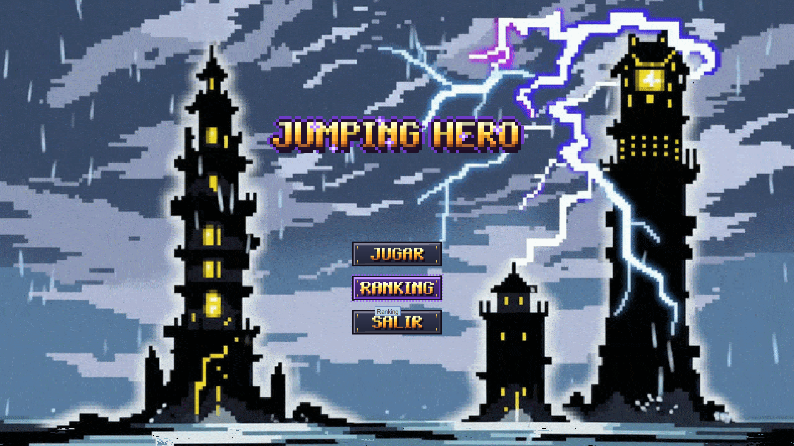
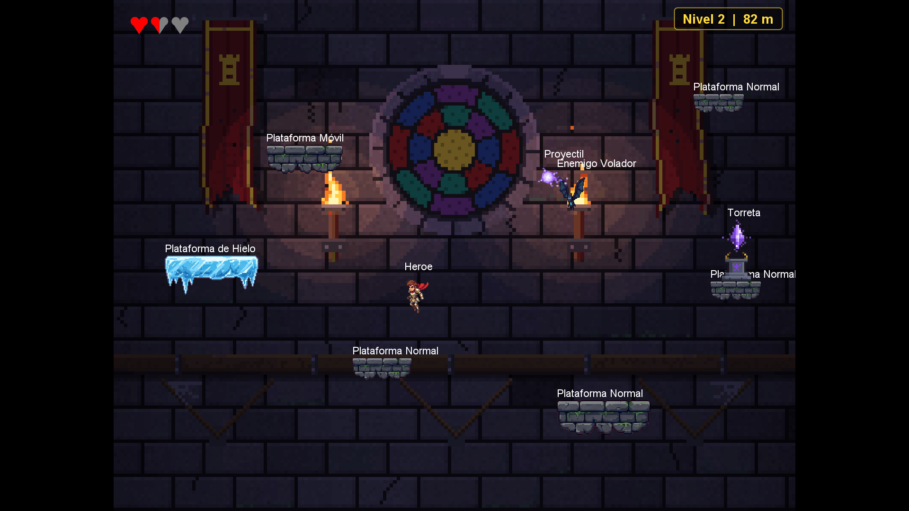
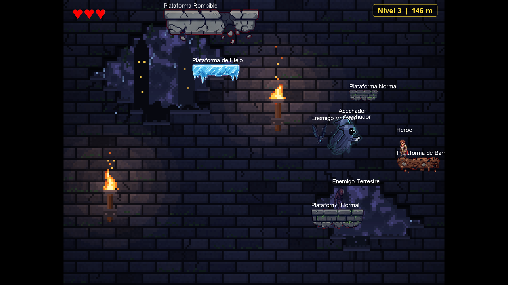
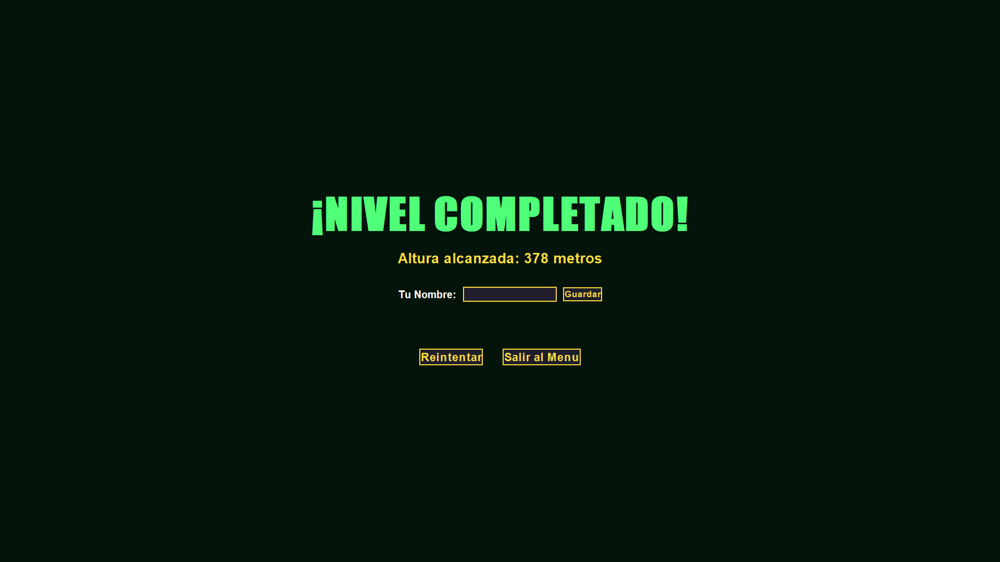
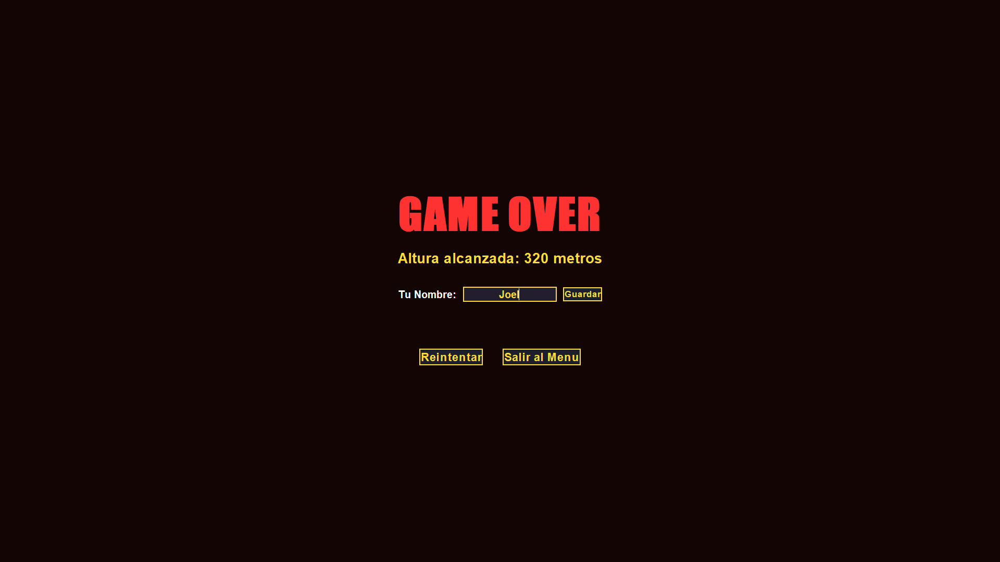
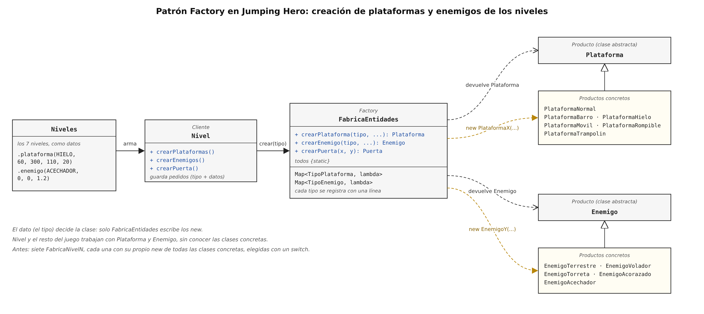
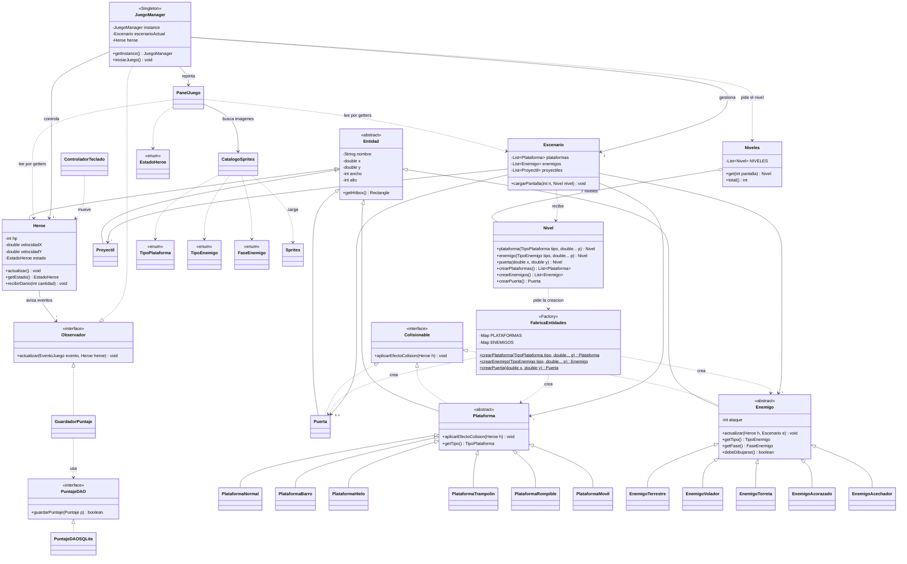

# Proyecto: Jumping Hero

## 1. Integrantes del Equipo 

- Cabrera, Joel. 
- Hidalgo,Lautaro.(Abandono)
- Millar,Juan Cruz.
- Valentino,Ernesto Paez.(Abandono) 

## 2.Dominio y Alcance del Sistema.

### Descripcion del problema

Buscamos desarrollar una aplicacion de escritorio del juego Jump king. El jugador debera controlar al personaje usando el salto como su principal movimiento,subiendo las plataformas,esquivando enemigos y calculando los saltos ya que entre mas tiempo tenga pulsado el boton de salto la distancia sera mayor para llegar a la cima.

### Objetivo del Sistema.

El sistema sera un videojuego funcional desarrollado bajo el paradigma de Programa Orientado a Objetos(POO).Su diseño debe ser modular, asi se facilitara futuras incorporaciones de nuevos tipo de plataformas (ej: resbaladizas, rompibles,etc),comportamiento de enemigos y escenarios.Tambien se dara mucha importancia a la correcta implementacion de fisicas basicas(gravedad,calculo de trayectorias) y en la deteccion de colisones en tiempo real entre las distintas entidades del juego(Jugador - Enemigo-Escenario).

### Funcionalidades principales (Features).

- **Mecanicas del Jugador y Fisicas:**
-El jugador puede moverse horizontalmente.
-El sistema de salto sera dinamico, ya que la altura y distancia de la parabola se calcula en base al tiempo que se mantenga pulsado el boton de salto.
-Se aplica constante de gravedad y mecanicas de caida libre.

- **Entorno y Colisiones**
-Posicionamiento estatico de plataformas para crear  un mapa de progresion vertical.
-Sistema de deteccion de colisiones(hitboxes) preciso entre el jugador,los limites de la pantalla y las superficies de las plataformas.

- **Sistema de Obstaculos y Enemigos:**
-Generacion de entidades hostiles en el mapa con patrones de movimiento simple.
-Deteccion de colisiones con enemigos que penalicen al jugador (ej: interrumpiendo el salto, empujandolo hacia abajo o quitando vida).

-**Interfaz Grafica(IGU):**
-Renderizado visualdel personaje , los enemigos, las plataformas y el entorno.
-Indicador visual en pantalla (barra de potencia) que muestre la fuerza de carga del salto en tiempo real.

- **Condiciones de Juego:**
-Ausencia de Game over tradicional: el castigo por fallar es la perdida de progreso al caer o poner Game Over si aplicamos vidas.
-Condicion de victoria al alcanzar la plataforma mas alta del nivel.

- **Persistencia**
-Sistema de guardado y carga del estado de la pantalla.
-Almacenamiento local de los datos del jugador(como las coordenadas exactas del personaje) para permitir retomar el ascenso en sesiones futuras

## 3.Capturas del Juego

### Menú principal

### Juego en acción

### Plataformas y enemigos

### Puerta de meta y victoria

### Game Over y ranking

## 4. Arquitectura y Diseño
### Arquitectura MVC

El proyecto está separado en tres capas, y cada una tiene una única responsabilidad:

| Capa | Paquete | Qué hace |
|---|---|---|
| Modelo | `modelo` | Estado y reglas del juego (posiciones, física, vida, colisiones). No importa Swing, ni la vista, ni el controlador, así que funciona y se puede probar sin ventana. |
| Vista | `vista` | Todo lo que se dibuja: `PanelJuego`, `CatalogoSprites` (carga de imágenes) y `Sprites`. Lee el modelo por getters y decide qué fotograma mostrar. |
| Controlador | `controlador` | `App` arma todo, `ControladorTeclado` traduce teclas en acciones del héroe y `JuegoManager` corre el bucle del juego. |

Decisiones de diseño:

- **El modelo no conoce imágenes ni colores.** En lugar de guardar un sprite, cada entidad expone *qué es* (`TipoEnemigo`, `TipoPlataforma`) y *qué está haciendo* (`EstadoHeroe`, `FaseEnemigo`). La vista usa esos enums para buscar la imagen en `CatalogoSprites`.
- **Los métodos "consulta" de `Enemigo`** (`debeDibujarse()`, `mirandoDerecha()`, `getFase()`, `getMsEnFase()`) tienen un valor por defecto y cada enemigo redefine solo los que necesita. Así la vista no pregunta de qué clase es cada enemigo y no hay ningún `instanceof` en el proyecto.
- **`java.awt.Rectangle` se mantiene en el modelo** solo como figura geométrica para detectar colisiones. No dibuja nada y funciona sin ventana.
- **Observer:** `Heroe` avisa los eventos (`HEROE_MURIO`, `NIVEL_COMPLETADO`) a sus observadores (`JuegoManager` y `GuardadorPuntaje`), que implementan `Observador`.

## Entrega: Aplicación de Patrones de Diseño
### 1. El problema: un enfoque con errores de diseño
Inicialmente, la clase "Escenario" era la responsable directa de instanciar cada plataforma y cada enemigo de todas las pantallas del juego mediante una estructura condicional basada en el número de pantalla:
#### Escenario.java (Versión anterior con errores de diseño)

Si sumamos más enemigos y plataformas, este bloque crece sin control...

**Problemas de este enfoque:**

-**Violación del Principio Abierto/Cerrado(OCP)**:Cada vez que se desea incorporar una nueva pantalla (Nivel 3, Nivel 4, etc.), es obligatorio abrir y modificar la clase Escenario, alterando código existente y arriesgando la estabilidad de los niveles previos.

-**Violación del Principio de Responsabilidad Única(SRP)**: La clase Escenario asumía dos responsabilidades no relacionadas: gestionar las entidades activas durante la ejecución del juego y, al mismo tiempo, actuar como ensamblador artesanal de cada nivel.

-**Alto acoplamiento**: Escenario dependía directamente de todas y cada una de las clases concretas de plataformas (PlataformaNormal, PlataformaBarro, etc.) y de enemigos (EnemigoTerrestre, EnemigoVolador, EnemigoAcorazado, EnemigoTorreta).

-**Con 10 o 20 niveles y decenas de elementos por nivel, la clase Escenario se convertía en un archivo inmanejable de cientos de líneas dedicadas puramente a la instanciación de objetos.**

### 2. Segunda versión: una clase por nivel (y por qué no era un patrón)

Se movió cada nivel a su propia clase (`FabricaNivel1..7`) que implementaba una interfaz `FabricaNivel`, y `JuegoManager` elegía cuál usar con un `switch`. Se presentó como Abstract Factory, pero no lo era: cada clase armaba un nivel fijo escrito a mano, no había una familia de productos intercambiable, y la elección dependía de un `switch`. Eran siete clases casi iguales y, para agregar un nivel, había que tocar el `switch`.

### 3. Versión actual: niveles como datos y un Factory de entidades

Un **Factory** es una clase que, a partir de un dato, decide qué clase concreta instanciar, de modo que el resto del código no escribe `new` de clases concretas. Acá el dato es el *tipo* (`TipoPlataforma`, `TipoEnemigo`).

`FabricaEntidades` es el Factory: es la única clase que escribe los `new` de plataformas y enemigos, y la clase concreta la decide un dato (el tipo, `TipoPlataforma` o `TipoEnemigo`) y no una variante de creador, por eso no es Factory Method. `Nivel` (el cliente) solo describe qué contiene un nivel, y `Escenario` guarda lo que se creó sin conocer ninguna clase concreta.

#### Beneficios

- **Abierto/Cerrado:** para agregar un nivel solo se suma un `Nivel` a `Niveles`. Para agregar un tipo de enemigo se agrega una línea en el `Map` de la fábrica. No se modifica `Escenario` ni `JuegoManager`.
- **Menos código:** se eliminaron `FabricaNivel` y `FabricaNivel1..7` (8 clases) y el `switch`.
- **Desacoplamiento:** `Escenario` y `Nivel` trabajan con `Plataforma` y `Enemigo`, y solo `FabricaEntidades` conoce las clases concretas.

#### Limitaciones Existentes 

- Los métodos de `FabricaEntidades` son `static`, así que no se pueden reemplazar en un test (es una desventaja que menciona la teoría del Factory).
- Los parámetros viajan como `double...` posicionales, que son menos seguros que un constructor con tipos.
- Agregar un tipo nuevo toca el enum, el `Map` de la fábrica y `CatalogoSprites`.

### Diagramas de Diseño

#### **Diagrama de Clases UML (Conceptual)**

#### **Prototipo de la IGU (Wireframe)**

## 5. Como ejecutar el juego

1. Instalar un JDK 17 o superior y abrir la carpeta del proyecto en VS Code con la extensión "Extension Pack for Java".
2. El driver de SQLite ya está incluido en `trabajo-final-2026-G22/lib/sqlite-jdbc-3.50.3.0.jar`.
3. Ejecutar la clase `src/controlador/App.java` (botón Run).
4. La base de datos `Ranking.db` se crea sola la primera vez.

**Controles:** flechas o A/D para moverse, mantener ESPACIO para cargar el salto y soltarlo para saltar, F11 para pantalla completa.

Nota: con Java 22 o superior aparece un aviso de SQLite sobre acceso nativo. No es un error.

## 6. Stack Tecnológico

- **Lenguaje:** Java (Versión 17 o superior)
- **IDE:** VS Code
- **Persistencia de Datos:** SQLite con JDBC
- **Framework de IGU:** Java Swing 
- **Control de Versiones:** Git y GitHub

## 7. Herencia y Polimorfismo (Segunda Entrega)

### Herencia

Se usa herencia simple para no repetir atributos ni código:

- **`Entidad`** es la clase abstracta base. Guarda lo mínimo que comparten todos los objetos del mapa: `nombre`, posición (`x`, `y`) y tamaño (`ancho`, `alto`), y calcula su `getHitbox()`. De ella heredan `Heroe`, `Enemigo`, `Plataforma`, `Proyectil` y `Puerta`. La vida, la velocidad y los demás datos propios están en cada clase que los necesita (por ejemplo `hp` en `Heroe`).
- **`Plataforma`** define lo genérico de una plataforma. Sus hijas (`PlataformaHielo`, `PlataformaBarro`, `PlataformaMovil`, `PlataformaRompible`, `PlataformaTrampolin`, `PlataformaNormal`) redefinen solo lo que cambia, como la fricción o el efecto sobre el héroe.
- **`Enemigo`** define lo común (ataque, colisión con el héroe) y cada tipo (`EnemigoTerrestre`, `EnemigoVolador`, `EnemigoTorreta`, `EnemigoAcorazado`, `EnemigoAcechador`) implementa su propio comportamiento en `actualizar(...)`.

### Polimorfismo

Se aplica para que el motor del juego no tenga que preguntar de qué clase es cada objeto. No hay ningún `instanceof` ni cadenas de `if/else` por tipo:

- **Colisiones:** `JuegoManager` llama a `plataforma.aplicarEfectoColision(heroe)` o `enemigo.aplicarEfectoColision(heroe)`, y cada clase hija decide qué efecto aplica (hielo que resbala, trampolín que impulsa, enemigo que daña). Si se agrega un obstáculo nuevo, no se modifica el motor: solo se crea la clase.
- **Comportamiento por tipo:** `actualizar(...)` en `Enemigo` es abstracto y cada enemigo lo implementa a su manera (patrulla, vuelo, disparo, persecución).
- **Dibujo sin `instanceof`:** la vista le pregunta a cada enemigo `getTipo()`, `getFase()`, `mirandoDerecha()` y `debeDibujarse()`. Cada clase devuelve su propio valor (o el valor por defecto de `Enemigo`) y `CatalogoSprites` elige la imagen según esos datos.
- **Creación:** el Factory (`FabricaEntidades`) devuelve objetos del tipo abstracto (`Plataforma`, `Enemigo`), de modo que `Nivel` y `Escenario` los usan sin conocer la clase concreta.