# Proyecto: Jumping Hero

## 1. Integrantes del Equipo 

- Cabrera, Joel. 
- Hidalgo,Lautaro.
- Millar,Juan Cruz.
- Valentino,Ernesto Paez.

## 2.Dominio y Alcance del Sistema.

### Descripcion del problema

Buscamos desarrollar una aplicacion de escritorio del juego Jump king. El jugador debera controlar al personaje usando el salto como su principal movimiento,subiendo las plataformas,esquivando enemigos y calculando los saltos ya que entre mas tiempo tenga pulsado el boton de salto la distancia sera mayor para llegar a la cima.

### Objetivo del Sistema.

El sistema sera un videojuego funcional desarrollado bajo el paradigma de Programa Orientado a Objetos(POO).Su diseño debe ser modular, asi se facilitara futuras incorporaciones de nuevos tipo de plataformas (ej: resbaladizas, rompibles,etc),comportamiento de enemigos y escenarios.Tambien se dara mucha importancia a la correcta implementacion de fisicas basicas(gravedad,calculo de trayectorias) y en la deteccion de colisones en tiempo real entre las distintas entidades del juego(Jugador - Enemigo-Escenario).

### Funcionalidades principales (Features).

- **Mecanicas del Jugador y Fisicas:**
-El jugador puede moverse horizontalmente.
-El sistema de salto sera dinamico, ya que la altura y distancia de la parabola se calcula en base al tiempo que se mantenga pulsado el boton de salto.
-Se aplica constante de gravedad y mecanicas de caida libre.

- **Entorno y Colisiones**
-Posicionamiento estatico de plataformas para crear  un mapa de progresion vertical.
-Sistema de deteccion de colisiones(hitboxes) preciso entre el jugador,los limites de la pantalla y las superficies de las plataformas.

- **Sistema de Obstaculos y Enemigos:**
-Generacion de entidades hostiles en el mapa con patrones de movimiento simple.
-Deteccion de colisiones con enemigos que penalicen al jugador (ej: interrumpiendo el salto, empujandolo hacia abajo o quitando vida).

-**Interfaz Grafica(IGU):**
-Renderizado visualdel personaje , los enemigos, las plataformas y el entorno.
-Indicador visual en pantalla (barra de potencia) que muestre la fuerza de carga del salto en tiempo real.

- **Condiciones de Juego:**
-Ausencia de Game over tradicional: el castigo por fallar es la perdida de progreso al caer o poner Game Over si aplicamos vidas.
-Condicion de victoria al alcanzar la plataforma mas alta del nivel.

- **Persistencia**
-Sistema de guardado y carga del estado de la pantalla.
-Almacenamiento local de los datos del jugador(como las coordenadas exactas del personaje) para permitir retomar el ascenso en sesiones futuras

## 3.Capturas del Juego

### Menú principal

### Juego en acción

### Plataformas y enemigos

### Puerta de meta y victoria

### Game Over y ranking

## 4. Arquitectura y Diseño

## Entrega: Aplicación de Patrones de Diseño
### 1. El problema: un enfoque con errores de diseño
Inicialmente, la clase "Escenario" era la responsable directa de instanciar cada plataforma y cada enemigo de todas las pantallas del juego mediante una estructura condicional basada en el número de pantalla:
#### Escenario.java (Versión anterior con errores de diseño)

Si sumamos más enemigos y plataformas, este bloque crece sin control...

**Problemas de este enfoque:**

-**Violación del Principio Abierto/Cerrado(OCP)**:Cada vez que se desea incorporar una nueva pantalla (Nivel 3, Nivel 4, etc.), es obligatorio abrir y modificar la clase Escenario, alterando código existente y arriesgando la estabilidad de los niveles previos.

-**Violación del Principio de Responsabilidad Única(SRP)**: La clase Escenario asumía dos responsabilidades no relacionadas: gestionar las entidades activas durante la ejecución del juego y, al mismo tiempo, actuar como ensamblador artesanal de cada nivel.

-**Alto acoplamiento**: Escenario dependía directamente de todas y cada una de las clases concretas de plataformas (PlataformaNormal, PlataformaBarro, etc.) y de enemigos (EnemigoTerrestre, EnemigoVolador, EnemigoAcorazado, EnemigoTorreta).

-**Con 10 o 20 niveles y decenas de elementos por nivel, la clase Escenario se convertía en un archivo inmanejable de cientos de líneas dedicadas puramente a la instanciación de objetos.**

2. **Patrón aplicado: Abstract Factory (Fábrica Abstracta)**

Para resolver este problema se implementó el patrón Abstract Factory. Se delegó la creación de las familias de elementos de cada pantalla (plataformas y enemigos) a fábricas especializadas e intercambiables, desacoplando completamente a Escenario de las clases concretas.

Diagrama de clases

Implementación
FabricaNivel.java (Interfaz de la Fábrica)

FabricaNivel1.java (Fábrica de la Pantalla 1)

FabricaNivel2.java (Fábrica de la Pantalla 2)

Escenario.java (Cliente actualizado)

Con este diseño tenemos beneficios:

-**Extensibilidad**: Si queremos agregar un Nivel 3, solo creamos la clase FabricaNivel3 implements FabricaNivel. No se toca ni una sola línea de código existente en Escenario.

-**Cohesión y legibilidad**: Cada nivel administra sus propias coordenadas y composición de manera aislada y ordenada.

-**Desacoplamiento**: Escenario solo conoce las abstracciones FabricaNivel, Plataforma y Enemigo. No conoce constructores ni implementaciones concretas.

### Diagramas de Diseño

#### **Diagrama de Clases UML (Conceptual)**

```mermaid
classDiagram
    namespace modelo {
        class Entidad {
            <<abstract>>
            -String nombre
            -double x
            -double y
            -int ancho
            -int alto
            +getNombre() String
            +getX() double
            +setX(double x)
            +getY() double
            +setY(double y)
            +getAncho() int
            +getAlto() int
            +getHitbox() Rectangle
            +getTipo()* TipoEntidad
        }

        class EntidadHostil {
            <<abstract>>
            -int ataque
            +getAtaque() int
            +aplicarEfectoColision(Heroe h)
        }

        class Heroe {
            -int hp
            -int hpMax
            -double velocidadX
            -double velocidadY
            -double cargaSalto
            -boolean cargandoSalto
            -boolean enElSuelo
            -boolean mirandoDerecha
            -List~Observador~ observadores
            -EstadoHeroe estado
            +actualizar()
            +moverIzquierda()
            +moverDerecha()
            +iniciarCargaSalto()
            +ejecutarSalto()
            +recibirDanio(int cantidad)
            +completarNivel()
            +agregarObservador(Observador o) boolean
            +quitarObservador(Observador o) boolean
        }

        class Plataforma {
            <<abstract>>
            +aplicarEfectoColision(Heroe h)
            +alGolpearDesdeAbajo(Heroe h)
            +actualizar()
            +debeEliminarse() boolean
        }

        class PlataformaNormal {
            +getTipo() TipoEntidad
        }
        class PlataformaBarro {
            -double reduccionVelocidad
            +aplicarEfectoColision(Heroe h)
            +getTipo() TipoEntidad
        }
        class PlataformaHielo {
            +aplicarEfectoColision(Heroe h)
            +getTipo() TipoEntidad
        }
        class PlataformaMovil {
            -double velocidadX
            -double limiteIzquierdo
            -double limiteDerecho
            -boolean moviendoDerecha
            +mover()
            +actualizar()
            +aplicarEfectoColision(Heroe h)
            +getTipo() TipoEntidad
        }
        class PlataformaRompible {
            -boolean destruida
            +romper()
            +aplicarEfectoColision(Heroe h)
            +alGolpearDesdeAbajo(Heroe h)
            +debeEliminarse() boolean
            +getTipo() TipoEntidad
        }
        class PlataformaTrampolin {
            -double multiplicadorRebote
            +aplicarEfectoColision(Heroe h)
            +getTipo() TipoEntidad
        }

        class Enemigo {
            <<abstract>>
            +actualizar(Heroe heroe, Escenario escenario)*
            +isVisible() boolean
            +isMirandoDerecha() boolean
            +getEstado() EstadoEnemigo
            +getTicksEnEstado() int
        }

        class EnemigoTerrestre {
            -double velocidadPatrullaje
            -double limiteIzquierdo
            -double limiteDerecho
            -boolean moviendoseDerecha
            +actualizar(Heroe heroe, Escenario escenario)
            +getTipo() TipoEntidad
        }
        class EnemigoVolador {
            -double amplitudVuelo
            -double centroY
            -double angulo
            +flotarVerticalmente()
            +actualizar(Heroe heroe, Escenario escenario)
            +getTipo() TipoEntidad
        }
        class EnemigoAcechador {
            -double tiempoDeteccion
            -double VELOCIDAD_PERSECUCION
            -EstadoEnemigo estado
            +perseguir(Heroe h)
            +actualizar(Heroe heroe, Escenario escenario)
            +aplicarEfectoColision(Heroe h)
            +getHitbox() Rectangle
            +getTipo() TipoEntidad
        }
        class EnemigoAcorazado {
            -double velocidadPatrullaje
            +aplicarEfectoColision(Heroe h)
            +actualizar(Heroe heroe, Escenario escenario)
            +getTipo() TipoEntidad
        }
        class EnemigoTorreta {
            -int cadenciaDisparo
            -long ultimoDisparo
            -EstadoEnemigo estado
            +disparar(Heroe h) Proyectil
            +actualizar(Heroe heroe, Escenario escenario)
            +getTipo() TipoEntidad
        }

        class Proyectil {
            -double velocidadX
            -double velocidadY
            -boolean impacto
            +actualizar()
            +aplicarEfectoColision(Heroe h)
            +debeEliminarse() boolean
            +getTipo() TipoEntidad
        }

        class Puerta {
            +aplicarEfectoColision(Heroe h)
            +getTipo() TipoEntidad
        }

        class Escenario {
            -List~Plataforma~ plataformas
            -List~Enemigo~ enemigos
            -List~Proyectil~ proyectiles
            -int pantallaActual
            -Puerta puerta
            +cargarPantalla(int numeroPantalla, Nivel nivel)
            +getPlataformas() List~Plataforma~
            +getEnemigos() List~Enemigo~
            +getProyectiles() List~Proyectil~
            +getPuerta() Puerta
        }

        class Puntaje {
            -String jugador
            -int puntos
            +getJugador() String
            +getPuntos() int
        }

        class Colisionable {
            <<interface>>
            +aplicarEfectoColision(Heroe h)*
        }

        class Observador {
            <<interface>>
            +actualizar(EventoJuego evento, Heroe heroe)*
        }

        class PuntajeDAO {
            <<interface>>
            +guardar(Puntaje puntaje) boolean*
            +mejores(int cantidad) List~Puntaje~*
        }

        class Nivel {
            <<interface>>
            +crearEnemigos() List~Enemigo~*
            +crearPlataformas() List~Plataforma~*
            +crearPuerta() Puerta
        }

        class Nivel1 { Implements Nivel }
        class Nivel2 { Implements Nivel }
        class Nivel3 { Implements Nivel }
        class Nivel4 { Implements Nivel }
        class Nivel5 { Implements Nivel }
        class Nivel6 { Implements Nivel }
        class Nivel7 { Implements Nivel }

        class TipoEntidad { <<enumeration>> }
        class EstadoHeroe { <<enumeration>> }
        class EstadoEnemigo { <<enumeration>> }
        class EventoJuego { <<enumeration>> }
    }

    namespace controlador {
        class App {
            +main(String[] args)$
        }

        class JuegoManager {
            -JuegoManager instance$
            -Escenario escenarioActual
            -Heroe heroe
            -boolean juegoCorriendo
            -PanelJuego vista
            -Runnable eventoGameOver
            -Runnable eventoNivelCompletado
            -int metrosMaximosAlcanzados
            +getInstance() JuegoManager$
            +iniciarJuego()
            -buclePrincipal()
            -actualizarFisicas()
            -verificarColisiones()
            +crearNivel(int pantalla) Nivel$
            +actualizar(EventoJuego evento, Heroe heroe)
        }

        class ControladorTeclado {
            -Heroe heroe
            -Escenario escenario
            +keyPressed(KeyEvent e)
            +keyReleased(KeyEvent e)
        }

        class GuardadorPuntaje {
            -PuntajeDAO dao
            -int ultimosMetros
            +actualizar(EventoJuego evento, Heroe heroe)
            +guardarPuntaje(String jugador, int metros) boolean
            +obtenerMejoresPuntajes(int cantidad) List~Puntaje~
        }
    }

    namespace persistencia {
        class Conexion {
            -Conexion instancia$
            -Connection conexion
            +getInstancia() Conexion$
            +get() Connection
        }

        class PuntajeDAOSQLite {
            -Connection conexion
            -crearTablaSiNoExiste()
            +guardar(Puntaje p) boolean
            +mejores(int cantidad) List~Puntaje~
        }
    }

    namespace vista {
        class VentanaJuego {
            -boolean pantallaCompleta
            +alternarPantallaCompleta()
            +cambiarPanel(JPanel nuevoPanel)
        }

        class PanelJuego {
            -Escenario escenario
            -Heroe heroe
            -CatalogoSprites catalogo
            +paintComponent(Graphics g)
            +reproducirMusica()
            +detenerMusica()
            +cargarFondoNivel(int nivel)
        }

        class MenuPrincipal {
            -JButton botonJugar
            -JButton botonRanking
            -JButton botonSalir
            +reproducirAudioAmbiente(String ruta)
            +detenerAudio()
        }

        class PantallaGameOver {
            -JTextField campoNombre
            -JButton botonGuardar
            -JButton botonReintentar
            -JButton botonMenu
            +mostrarPuntaje(int metros)
            +mostrarVictoria(int metros)
        }

        class CatalogoSprites {
            -Map cache
            +getImagen(TipoEntidad tipo) BufferedImage
            +getAnimacionHeroe(EstadoHeroe estado, boolean mirandoDerecha)
        }

        class Sprites {
            +cargar(String ruta)$
            +getEnemigoTerrestre()$
            +getHeroeQuieto()$
            +getSpritesPlataforma(int filaTipo)$
        }
    }

    %% Relaciones de Herencia e Implementacion
    Entidad <|-- EntidadHostil
    Entidad <|-- Heroe
    Entidad <|-- Plataforma
    Entidad <|-- Puerta
    EntidadHostil <|-- Enemigo
    EntidadHostil <|-- Proyectil
    
    Plataforma <|-- PlataformaNormal
    Plataforma <|-- PlataformaBarro
    Plataforma <|-- PlataformaHielo
    Plataforma <|-- PlataformaMovil
    Plataforma <|-- PlataformaRompible
    Plataforma <|-- PlataformaTrampolin

    Enemigo <|-- EnemigoTerrestre
    Enemigo <|-- EnemigoVolador
    Enemigo <|-- EnemigoAcechador
    Enemigo <|-- EnemigoAcorazado
    Enemigo <|-- EnemigoTorreta

    EntidadHostil ..|> Colisionable
    Plataforma ..|> Colisionable
    Puerta ..|> Colisionable

    Nivel1 ..|> Nivel
    Nivel2 ..|> Nivel
    Nivel3 ..|> Nivel
    Nivel4 ..|> Nivel
    Nivel5 ..|> Nivel
    Nivel6 ..|> Nivel
    Nivel7 ..|> Nivel

    JuegoManager ..|> Observador
    GuardadorPuntaje ..|> Observador
    PuntajeDAOSQLite ..|> PuntajeDAO

    %% Relaciones de Asociación y Composición
    Escenario "1" *-- "*" Plataforma
    Escenario "1" *-- "*" Enemigo
    Escenario "1" *-- "*" Proyectil
    Escenario "1" o-- "0..1" Puerta

    Heroe "1" o-- "*" Observador
    JuegoManager "1" o-- "1" Escenario
    JuegoManager "1" o-- "1" Heroe
    JuegoManager "1" --> "1" PanelJuego
    
    ControladorTeclado --> Heroe
    ControladorTeclado --> Escenario
    GuardadorPuntaje --> PuntajeDAO

    PanelJuego --> CatalogoSprites
    CatalogoSprites ..> Sprites
    PuntajeDAOSQLite --> Conexion
```

#### **Prototipo de la IGU (Wireframe)**

## 5. Como ejecutar el juego

1. Instalar un JDK 17 o superior y abrir la carpeta del proyecto en VS Code con la extensión "Extension Pack for Java".
2. El driver de SQLite ya está incluido en `trabajo-final-2026-G22/lib/sqlite-jdbc-3.50.3.0.jar`.
3. Ejecutar la clase `src/controlador/App.java` (botón Run).
4. La base de datos `Ranking.db` se crea sola la primera vez.

**Controles:** flechas o A/D para moverse, mantener ESPACIO para cargar el salto y soltarlo para saltar, F11 para pantalla completa.

Nota: con Java 22 o superior aparece un aviso de SQLite sobre acceso nativo. No es un error.

## 6. Stack Tecnológico

- **Lenguaje:** Java (Versión 17 o superior)
- **IDE:** VS Code
- **Persistencia de Datos:** SQLite con JDBC
- **Framework de IGU:** Java Swing 
- **Control de Versiones:** Git y GitHub

## 7. Herencia y Polimorfismo(Segunda Entrega)

1. Herencia (Para no repetir código)
Básicamente aplicamos herencia simple para no escribir mil veces los mismos atributos y mantener la arquitectura ordenada.

Sistema de Entidades: En vez de programarle la vida, el nombre y las coordenadas al Héroe y después hacer lo mismo de cero para el Enemigo, creamos una clase abstracta padre llamada Entidad. De ahí heredan Heroe y Enemigo, llevándose toda esa base y sumando solo sus mecánicas específicas.

Plataformas: Hicimos la misma jugada. Tenemos una clase base Plataforma que se encarga de lo genérico (dibujarse en pantalla, detectar colisiones). De ahí sacamos las clases hijas como PlataformaHielo o PlataformaBarro, que heredan toda la física base pero modifican cosas puntuales como la fricción o la velocidad del jugador.

2. Polimorfismo
Lo implementamos más que nada en el sistema de interacciones y colisiones para mantener el motor del juego limpio.
En lugar de armar una cadena enorme de if/else preguntando con qué tipo de bloque o entidad chocó el jugador, usamos un método general. Gracias a la sobrescritura en las clases hijas, cuando ocurre una colisión, es el propio objeto el que define qué efecto aplicar (por ejemplo, alterar la velocidad si es hielo ). De esta forma, el bucle principal del juego solo llama a la acción genérica, y si el día de mañana agregamos un obstáculo nuevo, no necesitamos modificar la lógica del motor, solo creamos la clase nueva.
