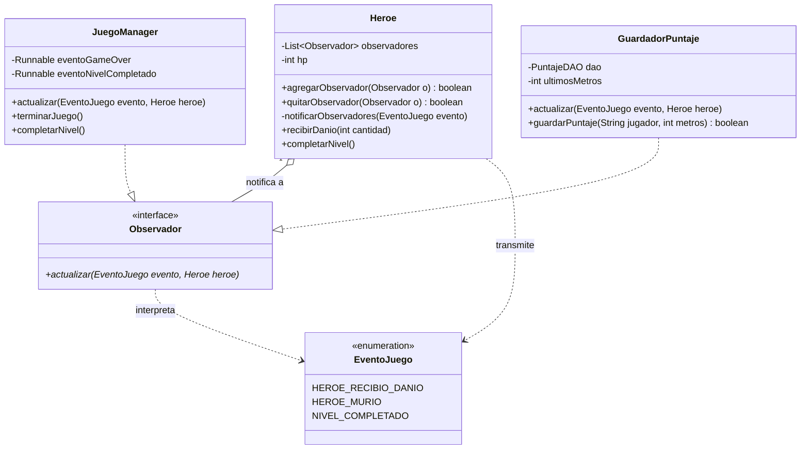

# Proyecto: Jumping Hero

## 1. Integrantes del Equipo 

- Cabrera, Joel. 
- Hidalgo,Lautaro.
- Millar,Juan Cruz.
- Valentino,Ernesto Paez.

## 2.Dominio y Alcance del Sistema.

### Descripcion del problema

Buscamos desarrollar una aplicacion de escritorio del juego Jump king. El jugador debera controlar al personaje usando el salto como su principal movimiento,subiendo las plataformas,esquivando enemigos y calculando los saltos ya que entre mas tiempo tenga pulsado el boton de salto la distancia sera mayor para llegar a la cima.

### Objetivo del Sistema.

El sistema sera un videojuego funcional desarrollado bajo el paradigma de Programa Orientado a Objetos(POO).Su diseño debe ser modular, asi se facilitara futuras incorporaciones de nuevos tipo de plataformas (ej: resbaladizas, rompibles,etc),comportamiento de enemigos y escenarios.Tambien se dara mucha importancia a la correcta implementacion de fisicas basicas(gravedad,calculo de trayectorias) y en la deteccion de colisones en tiempo real entre las distintas entidades del juego(Jugador - Enemigo-Escenario).

### Funcionalidades principales (Features).

- **Mecanicas del Jugador y Fisicas:**
-El jugador puede moverse horizontalmente.
-El sistema de salto sera dinamico, ya que la altura y distancia de la parabola se calcula en base al tiempo que se mantenga pulsado el boton de salto.
-Se aplica constante de gravedad y mecanicas de caida libre.

- **Entorno y Colisiones**
-Posicionamiento estatico de plataformas para crear  un mapa de progresion vertical.
-Sistema de deteccion de colisiones(hitboxes) preciso entre el jugador,los limites de la pantalla y las superficies de las plataformas.

- **Sistema de Obstaculos y Enemigos:**
-Generacion de entidades hostiles en el mapa con patrones de movimiento simple.
-Deteccion de colisiones con enemigos que penalicen al jugador (ej: interrumpiendo el salto, empujandolo hacia abajo o quitando vida).

-**Interfaz Grafica(IGU):**
-Renderizado visualdel personaje , los enemigos, las plataformas y el entorno.
-Indicador visual en pantalla (barra de potencia) que muestre la fuerza de carga del salto en tiempo real.

- **Condiciones de Juego:**
-Ausencia de Game over tradicional: el castigo por fallar es la perdida de progreso al caer o poner Game Over si aplicamos vidas.
-Condicion de victoria al alcanzar la plataforma mas alta del nivel.

- **Persistencia**
-Sistema de guardado y carga del estado de la pantalla.
-Almacenamiento local de los datos del jugador(como las coordenadas exactas del personaje) para permitir retomar el ascenso en sesiones futuras

## 3.Capturas del Juego

### Menú principal


### Juego en acción


### Plataformas y enemigos


### Puerta de meta y victoria


### Game Over y ranking


## 4. Arquitectura y Diseño

## Entrega: Aplicación de Patrones de Diseño
### 1. El problema: un enfoque con errores de diseño
Inicialmente, la clase "Escenario" era la responsable directa de instanciar cada plataforma y cada enemigo de todas las pantallas del juego mediante una estructura condicional basada en el número de pantalla:
#### Escenario.java (Versión anterior con errores de diseño)


Si sumamos más enemigos y plataformas, este bloque crece sin control...

**Problemas de este enfoque:**


-**Violación del Principio Abierto/Cerrado(OCP)**:Cada vez que se desea incorporar una nueva pantalla (Nivel 3, Nivel 4, etc.), es obligatorio abrir y modificar la clase Escenario, alterando código existente y arriesgando la estabilidad de los niveles previos.

-**Violación del Principio de Responsabilidad Única(SRP)**: La clase Escenario asumía dos responsabilidades no relacionadas: gestionar las entidades activas durante la ejecución del juego y, al mismo tiempo, actuar como ensamblador artesanal de cada nivel.

-**Alto acoplamiento**: Escenario dependía directamente de todas y cada una de las clases concretas de plataformas (PlataformaNormal, PlataformaBarro, etc.) y de enemigos (EnemigoTerrestre, EnemigoVolador, EnemigoAcorazado, EnemigoTorreta).

-**Con 10 o 20 niveles y decenas de elementos por nivel, la clase Escenario se convertía en un archivo inmanejable de cientos de líneas dedicadas puramente a la instanciación de objetos.**

#### Factory Method & Simple Factory
- **Factory Method:** Se definió la interfaz `Nivel` con los métodos abstractos `crearPlataformas()`, `crearEnemigos()` y el método default `crearPuerta()`. Cada pantalla del juego es una fábrica concreta (`Nivel1` a `Nivel7`) responsable de instanciar su propia composición de elementos.
- **Simple Factory:** El método estático `JuegoManager.crearNivel(int pantalla)` centraliza la selección de la fábrica de nivel correspondiente a la pantalla solicitada.
- **Beneficio:** `Escenario.cargarPantalla(int numero, Nivel nivel)` se vuelve agnóstico a las clases concretas; solo recibe la abstracción `Nivel` y delega la instanciación.

- Diagrama de clases
- IMPLEMENTACION
 ```mermaid
classDiagram
    class JuegoManager {
        +crearNivel(int pantalla)$ Nivel
    }

    class Escenario {
        -List~Plataforma~ plataformas
        -List~Enemigo~ enemigos
        -Puerta puerta
        +cargarPantalla(int numeroPantalla, Nivel nivel)
    }

    class Nivel {
        <<interface>>
        +crearPlataformas()* List~Plataforma~
        +crearEnemigos()* List~Enemigo~
        +crearPuerta() Puerta
    }

    class Nivel1 { +crearPlataformas() +crearEnemigos() }
    class Nivel2 { +crearPlataformas() +crearEnemigos() }
    class Nivel3 { +crearPlataformas() +crearEnemigos() }
    class Nivel4 { +crearPlataformas() +crearEnemigos() }
    class Nivel5 { +crearPlataformas() +crearEnemigos() }
    class Nivel6 { +crearPlataformas() +crearEnemigos() +crearPuerta() }
    class Nivel7 { +crearPlataformas() +crearEnemigos() }

    class Plataforma { <<abstract>> }
    class Enemigo { <<abstract>> }
    class Puerta

    JuegoManager ..> Nivel : instancializa (Simple Factory)
    Escenario ..> Nivel : consume
    
    Nivel1 ..|> Nivel
    Nivel2 ..|> Nivel
    Nivel3 ..|> Nivel
    Nivel4 ..|> Nivel
    Nivel5 ..|> Nivel
    Nivel6 ..|> Nivel
    Nivel7 ..|> Nivel

    Nivel ..> Plataforma : fabrica (Factory Method)
    Nivel ..> Enemigo : fabrica (Factory Method)
    Nivel ..> Puerta : fabrica (Factory Method)
  ```

Patrón Observer (Sujeto / Observador)
1. El problema: Polling activo y acoplamiento directo en la clase Heroe
Antes de implementar este patrón, la notificación de eventos críticos del juego (como la muerte del personaje o la victoria al tocar la meta) presentaba dos fallas principales de diseño:

Violación del patrón MVC y alto acoplamiento: Para que el héroe pudiera gatillar el fin de la partida o la persistencia del puntaje, la clase Heroe (Modelo) debía mantener referencias directas a JuegoManager (Controlador) y a GuardadorPuntaje (Persistencia). Esto contaminaba al Modelo con responsabilidades de flujo de pantalla y base de datos.

Polling activo (Active Polling) e ineficiencia: La alternativa sin acoplamiento era hacer que JuegoManager consultara manualmente en cada frame del bucle de juego (~60 FPS) si el héroe se había quedado sin vida (if (heroe.getHp() <= 0)). Esto sobrecargaba el ciclo de físicas con comprobaciones constantes y dispersaba la lógica de eventos.

Violación del Principio Abierto/Cerrado (OCP): Si en el futuro se deseaba agregar una nueva respuesta ante la muerte del personaje (por ejemplo, reproducir un efecto de sonido o registrar un logro), era obligatorio abrir y modificar la clase Heroe.

#### B. Patrón Observer (Sujeto / Observador)
- **Sujeto:** `Heroe` mantiene una lista thread-safe de observadores (`CopyOnWriteArrayList<Observador>`).
- **Observadores:** `JuegoManager` y `GuardadorPuntaje` implementan la interfaz `Observador`.
- **Funcionamiento:** Cuando el héroe muere (`HEROE_MURIO`) o completa la torre (`NIVEL_COMPLETADO`), notifica automáticamente a los observadores sin estar acoplado a la lógica de Game Over ni a la base de datos.
- **Beneficio:** Modelo Puro: Heroe ignora la existencia de Swing, de los paneles de UI y de la base de datos SQLite.

Extensibilidad (OCP): Es posible sumar N observadores nuevos (gestor de audio, estadísticas, logros) simplemente haciendo que implementen Observador y registrándolos en Heroe, sin tocar una sola línea del modelo.
Diagrama de clases



### Diagramas de Diseño

#### **Diagrama de Clases UML (Conceptual)**


#### **Prototipo de la IGU (Wireframe)**


## 5. Como ejecutar el juego

1. Instalar un JDK 17 o superior y abrir la carpeta del proyecto en VS Code con la extensión "Extension Pack for Java".
2. El driver de SQLite ya está incluido en `trabajo-final-2026-G22/lib/sqlite-jdbc-3.50.3.0.jar`.
3. Ejecutar la clase `src/controlador/App.java` (botón Run).
4. La base de datos `Ranking.db` se crea sola la primera vez.

**Controles:** flechas o A/D para moverse, mantener ESPACIO para cargar el salto y soltarlo para saltar, F11 para pantalla completa.

Nota: con Java 22 o superior aparece un aviso de SQLite sobre acceso nativo. No es un error.

## 6. Stack Tecnológico

- **Lenguaje:** Java (Versión 17 o superior)
- **IDE:** VS Code
- **Persistencia de Datos:** SQLite con JDBC
- **Framework de IGU:** Java Swing 
- **Control de Versiones:** Git y GitHub

## 7. Herencia y Polimorfismo(Segunda Entrega)
1. Jerarquía de Herencia
Para reutilizar código y evitar redundancias, el modelo se organiza en una jerarquía clara:

Clase Base Entidad: Define los 5 atributos esenciales de cualquier objeto del mapa (nombre, x, y, ancho, alto), los getters/setters correspondientes y el método genérico getHitbox().

Subclase EntidadHostil: Hereda de Entidad e incorpora el atributo ataque. Implementa la interfaz Colisionable definiendo la acción por defecto de restar vida al héroe (heroe.recibirDanio(this.ataque)).

Subclase Enemigo: Hereda de EntidadHostil y define el contrato abstracto actualizar(Heroe heroe, Escenario escenario) para la Inteligencia Artificial de los enemigos.

Enemigos Concretos: EnemigoTerrestre, EnemigoVolador, EnemigoAcechador, EnemigoAcorazado y EnemigoTorreta heredan de Enemigo reutilizando el manejo de vida y colisiones.

Subclase Plataforma: Hereda de Entidad e implementa Colisionable. Subclases como PlataformaNormal, PlataformaBarro, PlataformaHielo, PlataformaMovil, PlataformaRompible y PlataformaTrampolin refinan comportamientos físicos específicos.

2. Polimorfismo.
El polimorfismo permite al motor (JuegoManager) iterar sobre colecciones abstractas sin conocer el tipo exacto del objeto:

Bucle de Físicas (actualizar()): En cada frame, el motor recorre la lista List<Enemigo> invocando e.actualizar(heroe, escenario). Cada enemigo ejecuta su propia IA en tiempo de ejecución (el volador calcula la onda senoidal, la torreta dispara, el terrestre patrulla o persigue).

Sistema de Colisiones (aplicarEfectoColision()):

Los enemigos estándar (Terrestre, Volador) aprovechan la implementación base de EntidadHostil.

EnemigoAcorazado sobrescribe el método para restar vida y además empujar al héroe hacia atrás.

EnemigoAcechador sobrescribe el método para restar vida y cambiar su estado a desaparecer.

Proyectil sobrescribe el método para restar vida y consumirse/marcar impacto.

PlataformaTrampolin sobrescribe el método para impulsar al héroe hacia arriba.

PlataformaRompible sobrescribe el método para marcarse como destruida al ser pisada o golpeada desde abajo.
